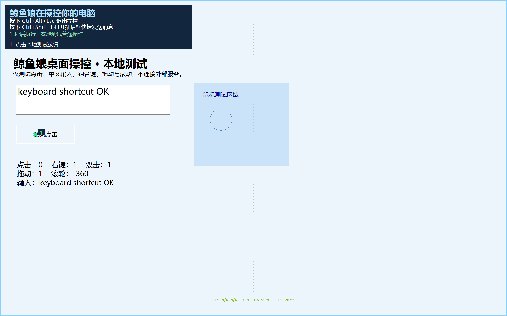

# 鲸鱼娘桌面操控 · v1.1.0

[](CHANGELOG.md)
[]()
[](LICENSE)
[]()

面向 DeepSeek Harness 的 Windows 单显示器插件：**模型看整屏截图**（不依赖控件树、不读无障碍树），提出一批鼠标键盘动作，
**预览一秒**后执行，再看新截图判断是否完成。敏感操作默认**交回用户手动完成**，而不是由模型代劳。



> English summary: a vision-only desktop-control plugin for DeepSeek Harness on Windows.
> The model sees a full-screen screenshot, proposes up to five mouse/keyboard actions, they are previewed
> for one second and then executed; sensitive categories (payment, deletion, external messages, credentials…)
> are handed back to the human by default. `Ctrl+Alt+Esc` stops everything, `Ctrl+Shift+I` opens an interject box.
> No control tree, no OCR, no extra ports — screenshots from Windows pixels, input via SendInput.

## 快速开始

1. 把本目录放到固定位置（之后不要移动，安装用的是目录链接）。
2. 完全退出 DSH 客户端，在本目录执行：

   ```powershell
   powershell -NoProfile -ExecutionPolicy Bypass -File .\install.ps1
   ```

3. 重新打开 DSH，在**新对话**里说：

   > 使用鲸鱼娘桌面操控，帮我在当前应用里完成……。先截图确认，完成后停止。

要求：Windows x64、.NET Framework 4.8、DSH 桌面客户端 `0.2.1-rc.2`、**能接收图片的模型**。

## 文档地图

| 文件 | 内容 |
|---|---|
| [CHANGELOG.md](CHANGELOG.md) | 版本变更 |
| [TEST_REPORT.md](TEST_REPORT.md) | 验证记录：哪些测过、哪些没测 |
| [REVIEW.md](REVIEW.md) | 一次完整实测评审 + 8 条改进建议（按精度/流畅度/安全/工程分组） |
| [ACCEPTANCE.md](ACCEPTANCE.md) | v1.1.0 四项改进的用户验收步骤；实机结果待填写 |

## 模型与快捷键

模型需要支持图片输入。截图交给当前 DSH 配置的模型；插件没有额外的模型接口或 API Key 配置。

- **Ctrl+Alt+Esc**：紧急停止。释放插件按住的键和鼠标、隐藏覆盖层，并锁住后续操控。
- **Ctrl+Shift+I**：打开插话框。可以直接补充需求，无需切到 DSH 窗口。
- 急停后：在系统托盘找到“鲸鱼娘桌面操控”，右键选择“恢复桌面操控”。模型没有恢复按钮。
- 助手被用户退出或发生崩溃后：在 DSH 插件页重新启用插件。它不会静默重启后继续原动作。

## 你可以决定哪些操作敏感

在 DSH 打开 **Settings（设置）→ Whale Computer Use（鲸鱼娘桌面操控）→ Open settings（打开设置）**。页面会显示敏感自动执行状态和已勾选的类别数量；点击按钮直接打开本机设置窗口，不调用模型、不消耗模型额度。

也可以让 DSH“打开鲸鱼娘桌面操控设置”，或在系统托盘双击助手图标。原生窗口保存后，在 DSH 设置页点击“刷新状态”查看最新值。

**从旧版本更新后，请完全退出并重新打开 DSH 客户端**，让设置页和新版原生助手一起加载。采用目录链接安装且目录未变时，无需重新安装。新版助手文件带版本号，不会覆盖仍在运行的旧助手；重启后才会使用新功能。

设置分为两部分，分别保存：

1. **敏感操作的范围**：付款、删除、对外发送、账号变更、权限变更、密码凭据、软件安装、系统配置、自定义关键词，均可逐项勾选。自定义关键词每行一个。
2. **是否自动执行敏感操作**：“自动执行敏感操作（完全权限）”默认关闭。关闭时，已勾选类别显示红色指引，整批动作交给你手动完成；开启后，这些动作也会在预览后自动执行。

未勾选的类别不再触发敏感保护，普通动作会自动执行。此设置控制插件的执行策略，不授予 Windows 管理员权限。

手动完成后按 Ctrl+Shift+I，点击“我已手动完成”，模型会再截图验证。默认等候 90 秒，可设置为 10–600 秒。超时只表示你未响应，**不表示同意执行**。模型只能尝试其他安全步骤，不能绕过同一敏感操作。

设置保存在 `%LOCALAPPDATA%\DSHWhaleComputer\settings.json`。重启后保留。模型工具没有修改敏感类别或自动执行开关的接口；打开设置时会暂停正在执行的动作。

敏感识别结合模型声明的风险类别和关键词匹配；视觉模型仍可能误判操作含义。这些保护不是对恶意模型的系统级安全隔离。密码类输入在覆盖层中隐藏，但用户交给模型的文字仍可能出现在 DSH 的上下文和工具日志中。

## 屏幕和坐标

每次截图自动读取主显示器的**实际像素尺寸**，完整捕获桌面、任务栏及可见应用，不依赖控件树或 OCR。模型看见的截图按比例缩放，默认最大宽度 1920，可在设置中调整。

模型使用返回图片的坐标；插件将它换算成真实屏幕坐标。例如 2560×1600 屏幕返回 1920×1200 图片，点击位置按比例映射，不要求手动填写分辨率。

主机和原生助手分别拒绝越界坐标。截图只能使用一次，120 秒后过期；分辨率、前台窗口或用户输入在截图后发生变化时，须重新截图。界面内容发生滚动、弹窗或页面跳转后，模型也应先看新图。

### 区域放大

小字、菜单项或小按钮难辨认时，模型可用最新截图的 `captureId` 和图片内的区域坐标请求放大：

```json
{"captureId":"最新截图的 ID","zoom":{"x":500,"y":300,"width":240,"height":160,"scale":2}}
```

`x/y/width/height` 都按**上一张返回图片**计算；`scale:1` 获取区域原生像素，`scale:2` 最多放大两倍，默认 2。输出限制为宽 3840、高 8192、总计 1200 万像素以内。可以继续放大当前区域；不带参数调用 capture 回到整屏。

在放大图上操作时直接使用**放大后返回图片**的坐标，插件负责换算屏幕偏移、缩放以及拖拽终点。每批执行后仍返回整屏，方便重新判断页面状态；本版尚未加入自动“点后局部复核”。

### 失效自动补拍

旧截图缺失、过期、前台变化、分辨率变化或发生真实输入时，旧动作不执行，工具尽量直接附带新整屏图，返回 `stale_capture` 和 `completed:0`。模型根据新图重新规划，无需为了取新图额外调用一次工具。失效的放大请求也会回到整屏，而不会在变化后的画面上套用旧区域。

用户在批次执行期间接管仍会中断；`interrupted` 保留实际完成数并尽量附带新图。急停、取消、输入窗口仍打开或补拍失败时不会强行恢复。`observationError` 会说明无法获得新图的原因。

输入判定改用低级键盘/鼠标钩子的真实输入计数；忽略带注入标记的事件，不再因为插件自己的注入输入误判用户接管。前台变化、真实键鼠接管和急停保护仍有效。

### 长任务批次上限

原生设置中的“任务批次上限”可设 **1–1000**，默认仍为 **80**，保存后重启保留；旧设置文件自动采用默认值。设置页可刷新查看当前上限，模型没有修改接口。

每次动作结果返回 `budget`，包含已处理批数、上限、剩余批数和实际完成的自动动作数。失效而未执行的批次不消耗上限。达到上限时自动结束操控，保留最后结果并要求模型总结进度；同一用户任务中调用 finish 或重试不会清零，等 DSH 本轮任务结束、用户发起新任务后重新计数。人工完成的动作不计入自动动作数。

当前实机验证设备为 **2560×1600、Windows 显示缩放 150%**。已对多组截图宽度和屏幕宽度做数学边界测试；其他显示器、DPI、游戏渲染方式尚未全部实测。坐标不会被接受到屏幕外，但模型仍可能在屏幕内认错目标。

## 覆盖层与输入

- 淡蓝色边框与可选四分区辅助线；显示“鲸鱼娘在操控你的电脑”和快捷键。
- 普通动作显示绿色圆点和顺序，敏感动作显示红色圆点或操作文字。
- 左上角展示输入内容、按键和批次说明；密码类别隐藏输入预览。
- 预览一秒后执行。一批 1–5 个动作；完成后自动返回新截图。
- 支持左右键、双击、中键、鼠标移动、水平/垂直滚动、拖拽、带修饰键的拖拽、Unicode 输入、组合键和等待。
- 覆盖层不抢焦点、不拦鼠标；只有设置和插话窗口接收焦点。截图时会短暂隐藏助手覆盖层，避免遮住底下的应用内容。
- 用户在执行期间使用真实键盘或鼠标，会中断当前批次。DSH 取消任务也会取消原生动作。
- 一个助手实例、一个 DSH 对话占用桌面；其他对话不能同时操控。

## 安装到其他机器或重新安装

需要 Windows x64、.NET Framework 4.8、已安装的 DSH 桌面客户端。已验证 DSH 版本：`0.2.1-rc.2`。

1. 将插件目录解压到固定位置。安装采用链接方式，之后不要移动或删除该目录。
2. 完全退出 DSH 客户端。
3. 在插件目录执行：

```powershell
powershell -NoProfile -ExecutionPolicy Bypass -File .\install.ps1
```

重新启动 DSH，在新对话中使用。安装脚本调用官方 `dsh plugin` 命令，将本插件加入 `desktop` profile。它不修改其他插件的启用状态。

也可在 DSH 的插件管理页面或 Creator 模式通过正常的本地目录安装流程安装本目录。不要同时启用会占用相同快捷键或操作桌面的旧版“桌面副驾”。快捷键注册失败时本助手会拒绝启动。

卸载时在 DSH 插件页移除本插件；如需保留自定义设置，可保留上述设置文件。

## 开发与工具

```powershell
# 编译原生助手
powershell -NoProfile -ExecutionPolicy Bypass -File .\build.ps1
# 不调用模型、不截图或注入输入的 JavaScript 检查
node --test tests/*.test.mjs
# 包含原生纯逻辑检查的完整离线测试，需要 Windows .NET Framework 4.8
powershell -NoProfile -ExecutionPolicy Bypass -File .\test.ps1
```

原生源码在 `native/`。`tests/NativeTests.cs` 验证敏感分类、设置持久化、按键和坐标映射；`tests/TestSurface.cs` 是输入验收用的独立本地窗口。截图来自 Windows 屏幕像素，输入使用 SendInput；原生助手与 DSH 通过私有标准输入输出通信，不新增网络端口。设置页通过 DSH 已有、仅限 owner 身份的连接读取状态和打开窗口，不发布设置修改接口。

模型工具：`whale_desktop_capture`、`whale_desktop_act`、`whale_desktop_control`。动作批次必须带最新 captureId 和每个动作的真实风险类别。工具输出区分 executed、manual_completed、manual_timeout、stale_capture、batch_limit、interrupted、stopped、failed，并报告真正完成了多少个动作。

## 支持边界

目前只做主显示器。UAC 安全桌面、锁屏、受保护视频、独占全屏或权限高于助手的窗口可能无法捕获或操作；遇到这些情形会报告错误，需用户手动处理。本插件不会关闭 UAC、修改安全策略或自动提权。

助手不会操作系统沙箱设置。是否允许加载本机原生插件由 DSH 的插件和宿主权限决定。
